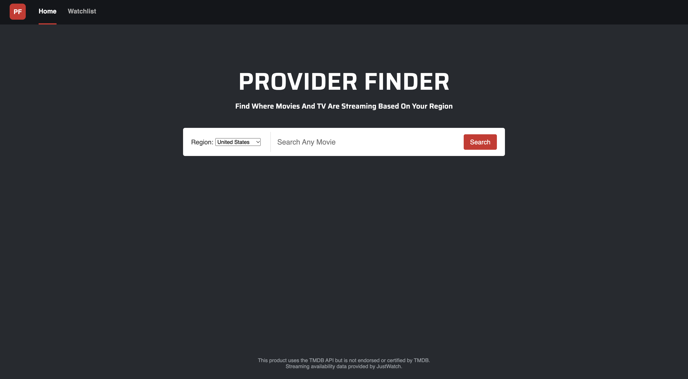
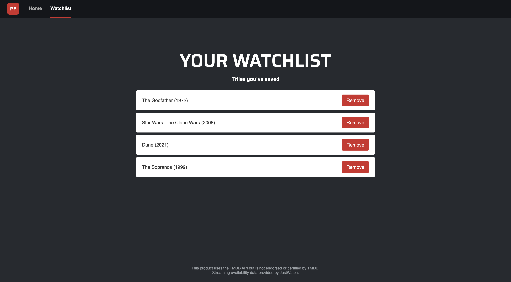
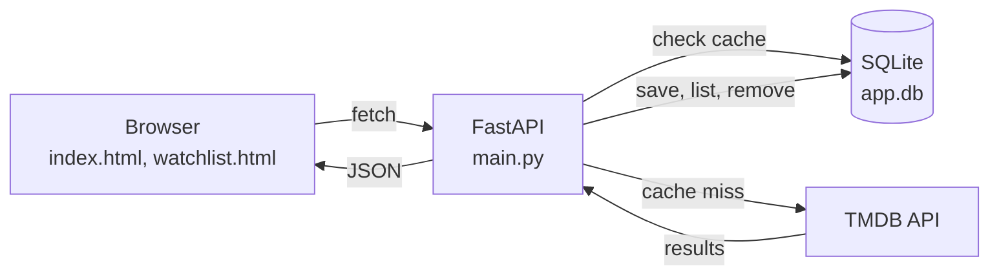

# Provider Finder

Search for a movie or TV show and see where it's streaming in your region, whether it's included with a subscription, free, free with ads, or available to rent or buy. Save titles to a watchlist to come back to later.

Built as a learning project to practice full-stack development: a Python backend that wraps a third-party API, a SQLite database, and a plain HTML/CSS/JavaScript frontend.




## Features

- Search movies and TV shows by title
- Pick a region and see availability by category (subscription, free, ads, rent, buy)
- Click a result to open or close its availability
- Save titles to a watchlist and remove them
- Search and availability results are cached in SQLite to reduce API calls

## Tech stack

- **Backend:** Python, FastAPI, Uvicorn
- **Data:** TMDB API (watch-provider data from JustWatch)
- **Database:** SQLite (watchlist and cache tables)
- **Frontend:** HTML, CSS, vanilla JavaScript (fetch, DOM)
- **Tools:** Git and GitHub (feature branches and pull requests)

## How it works



The browser calls the FastAPI backend, which checks the SQLite cache before asking TMDB. Fresh results are saved to the cache for next time. The watchlist is stored in the same database.

## API endpoints

| Method | Path | What it does |
|---|---|---|
| GET | `/search?q=...` | Search titles |
| GET | `/availability?media_type=...&tmdb_id=...&country=...` | Where a title streams in a region |
| GET | `/watchlist` | List saved titles |
| POST | `/watchlist` | Save a title |
| DELETE | `/watchlist/{item_id}` | Remove a saved title |

Interactive docs are available at `/docs` while the server is running.

## Run it locally

You need Python 3 and a free TMDB API key from themoviedb.org.

```bash
git clone https://github.com/nstewart05/provider-finder-web.git
cd provider-finder-web

python3 -m venv .venv
source .venv/bin/activate
pip install -r requirements.txt

echo "TMDB_API_KEY=your_key_here" > .env

uvicorn main:app --reload
```

Then open http://127.0.0.1:8000/app/ in your browser. The `.env` file and the SQLite database are created locally and are not committed.

## Project structure

```text
provider-finder-web/
├── main.py             FastAPI app and endpoints
├── tmdbsearch.py       Functions that call the TMDB API
├── database.py         SQLite setup, watchlist and cache functions
├── requirements.txt    Python dependencies
├── static/
│   ├── index.html      Search page
│   ├── index.js        Search, availability and watchlist button logic
│   ├── watchlist.html  Watchlist page
│   ├── watchlist.js    Loads and removes saved titles
│   └── style.css       Styles shared by both pages
├── screenshots/        Images used in this README
└── README.md
```


## What I learned
This was my first full-stack project, and I used it to learn several tools I had not used before. In my university courses I mostly used Python, C and Java, so this project introduced me to Python virtual environments, Git and GitHub, REST APIs, SQL, and HTML/CSS/JavaScript.

**Backend**
- Calling a third-party API from Python (`tmdbsearch.py`), handling errors, and keeping the API key in an environment variable out of version control.
- Building a FastAPI backend (`main.py`) with inputs that are valid and status codes (400, 404, 409).
- Designing SQLite tables for the watchlist and cache (`database.py`), writing my first SQL queries, and using `?` placeholders to prevent SQL injection.
- Caching API results with an expiry time to reduce repeated requests.

**Frontend**
- Learning HTML, CSS and JavaScript from scratch. I used W3Schools and a small weather app to practice the fetch-and-display pattern first.
- Using `fetch` with `async`/`await`, checking `response.ok` before parsing, and wrapping calls in `try/catch` so failures show a message.
- Building the page dynamically with the DOM, and structuring the code so the same patterns could be reused across search, availability, and the watchlist.

**Challenges**
- One challenge wat that The SQLite database file kept showing up as changed in Git even though it was in .gitignore. I found that the pattern *.db/ (with a trailing slash) only matches folders, so I changed it to *.db, and learned that .gitignore can’t hide a file Git is already tracking, so I had to untrack it with git rm --cached.
- Calling my own backend from JavaScript meant passing three values (media_type, tmdb_id, country) as URL parameters. I learned to build them with URLSearchParams from an object, which handles the formatting and encoding.
- Another JavaScript challenge was that it would crash with `Cannot read properties of null` when adding a click listener. The `<script>` tag was placed above the page content, so it ran before the button existed and `querySelector` returned `null`. Moving the script to the bottom of `<body>` fixed it, and I learned to read the console error to find out what specific line a problem was coming from.

**Workflow**
- Used feature branches and pull requests, and learned how `.gitignore` works, including its limits.

I plan to use the skills I developed during building this for future projects.

## Known limitations

- The watchlist is shared between everyone, since there are no user accounts.
- Availability shows which service carries a title, not which subscription tier is required. The data source doesn't provide tier-level information per title.
- Availability data can change, and cached results expire after a few hours.

## Possible next steps

- Autocomplete while typing
- User accounts with a separate watchlist per user
- Automated tests
- Deployment

## Attribution

This product uses the TMDB API but is not endorsed or certified by TMDB.
Streaming availability data provided by JustWatch.